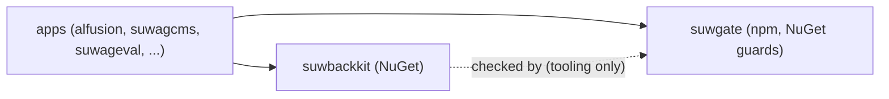

# Architecture

## What this repository is for

suwbackkit holds the .NET code that the backends of our apps share, published as NuGet packages, so an app takes a
version of it instead of a copy. A fix lands once and reaches every app with a version bump; a copy drifts.

- **Only code generalised from at least two apps comes here.** The second app that needs the same thing is what earns it a
  place; one app's need stays in that app, however general it looks. Before moving code here, compare the copies and keep
  only what they really share.
- No domain logic of any one app: what lives here is what any of our backends needs (server defaults, a CLI skeleton).
- One package per area, `Suwbackkit.<Area>`, so an app takes only what it uses. A new package arrives with its first code.

## Direction of dependencies

- Apps depend on suwbackkit; **suwbackkit never depends on an app**, never references one, and knows nothing of which apps use it.
- **suwgate does not depend on suwbackkit.** suwgate checks repositories, this one included; it ships no runtime code an app needs from here, and nothing here is a dependency of it.
- Inside the repository: a package may use another package of the kit only when the second one exists for that reason; tests depend on what they test, never the other way.

## The map

- `Suwbackkit.slnx` — the .NET solution: the packages and their tests.
- `src/` — one folder per package; everything under it is packed (`src/Directory.Build.props` holds the package metadata). Each package has its own `README.md`, which nuget.org shows.
- `tests/` — one xUnit v3 test project per package (`<Package>.Tests`), plus `Suwbackkit.Gate`: the gate script, the repository guards and the Claude Code hooks' scripts, until suwgate replaces them (TODO.md).
- `docs/` — this file and the specs: drafts in `draft/spec/`, built features in `visual/spec/`.
- `.github/workflows/ci.yml` — the gate on every push and pull request, and publishing on a version tag.
- `.claude/` — the committed Claude Code settings: a Stop hook that runs the quick gate, and a PreToolUse hook that protects the gate, the lint configs and the lockfiles (`ALLOW_GATE_EDIT=1 claude` lifts the first two).
- `.githooks/` — `pre-commit` runs gitleaks on what is being committed; `just sync` enables it.
- `.config/` — `dotnet-tools.json`: the pinned CSharpier.
- `.vscode/` — recommended extensions, formatter, file nesting and tasks that run the gate. No style rules: they live in `.editorconfig` and `.csharpierrc.json`.

Files at the root: `Directory.Build.props` (strict compiler and analyzers, nothing packable by default), `Directory.Build.rsp`
(no idle MSBuild workers), `Directory.Packages.props` (every package version, once, with transitive pinning),
`BannedSymbols.txt` (APIs the build refuses, each with what to use instead), `.editorconfig`, `global.json`, `nuget.config`, `.gitattributes`, `.gitignore`.

## The packages

- `Suwbackkit.Server` follows .NET Aspire's ServiceDefaults: one `AddServerDefaults()` on the builder, one `MapServerDefaults()` on the app.
  Aspire ships it as a project inside each solution; here it is a NuGet package, so a fix reaches every app with a version bump.
  Unlike Aspire, `/health` and `/alive` are mapped in every environment, because the apps run them as container probes.
- `Suwbackkit.Postgres` is its own package, so an app without a database pulls in neither Npgsql nor grate; it does not depend on
  `Suwbackkit.Server`, it only adds a check to `AddHealthChecks()`, which both share through ASP.NET Core. Dapper stays the app's choice.
- Both reference the ASP.NET Core shared framework (`FrameworkReference Microsoft.AspNetCore.App`): every app using them is an ASP.NET Core app.
- The public API is only what an app calls; the rest is internal and tested through `InternalsVisibleTo`.
- The tests that need PostgreSQL start it with Testcontainers (`postgres:17.11`, the image the apps' compose files pin). Without Docker
  they are skipped with a message that says how to run them; with `CI` set the missing Docker fails the run instead, so CI never passes
  without them.

## Packaging

Following the .NET library guidance and the NuGet docs:

- Every project under `src/` is packable and carries `PackageId`, `Description`, `Authors`, `PackageLicenseExpression` MIT,
  `RepositoryUrl`, `PackageReadmeFile`; everything else is `IsPackable=false` by default.
- Source Link is part of the .NET SDK since .NET 8 and on by default for GitHub, and so is embedding untracked sources;
  `PublishRepositoryUrl` writes the repository and the commit into the package.
- Symbols ship as a separate `.snupkg` (`IncludeSymbols`, `SymbolPackageFormat=snupkg`); `dotnet nuget push` of the `.nupkg` pushes the `.snupkg` beside it.
- Builds are deterministic (the SDK default); on GitHub Actions `ContinuousIntegrationBuild` also normalises the paths baked into the binaries.
- `dotnet pack` writes to `artifacts/packages` (gitignored); the gate checks that each package gives both files.

## Versioning

**MinVer: the version comes from the git tag.** Tag `v0.1.0` builds `0.1.0`; a commit after it builds `0.1.1-alpha.0.<height>`;
before the first tag, `0.1.0-alpha.0.<height>` (`MinVerMinimumMajorMinor` 0.1).

- Why a tag and not a version in `Directory.Build.props`: the tag is the one place the version lives, so the published version cannot
  disagree with the release; there is no bump commit to forget, and a pre-release between tags can never be mistaken for a release.
- All packages share one version and one tag (`v*`), released together: the simplest scheme while the kit is small and its packages move together.
  When one package needs its own cadence, MinVer's documented monorepo setup applies: a `MinVerTagPrefix` per project (`server-v`, `cli-v`)
  with `MinVerIgnoreHeight`.
- MinVer needs the full history: CI checks out with `fetch-depth: 0`.

## Publishing

On a pushed tag `v*`, after the gate passes, the `publish` job of `ci.yml` pushes the packages the gate built to nuget.org with
**NuGet trusted publishing**: GitHub issues the job an OIDC token, `NuGet/login` exchanges it for an API key valid one hour, and no
long-lived key is stored anywhere. Before pushing, it checks that every package carries exactly the tag's version.

The job does not run until the owner sets it up, so a tag without this setup publishes nothing:

1. On nuget.org, signed in as the account (or organisation) that will own the packages: user menu → Trusted Publishing → add a policy:
   repository owner `Manomenu`, repository `suwbackkit`, workflow file `ci.yml`, environment `nuget-org`.
2. On GitHub, in the repository's Settings → Secrets and variables → Actions → Variables: a repository variable `NUGET_USER` with the
   nuget.org profile name (not the e-mail). The job runs only when this variable is set.
3. Optionally, in Settings → Environments → `nuget-org`: required reviewers or a tag rule, so a publish waits for the owner's approval.

## The gate

`tests/Suwbackkit.Gate/scripts/check.sh` (`just check`, and the same in CI): locked restore, build in Release with warnings as errors,
CSharpier, every test, pack, shellcheck, gitleaks.

Each line is a build rule or a test; its message says the fix.

- Build: analyzers `latest-all`, warnings are errors, code style enforced in the build.
- Banned APIs (`BannedSymbols.txt`): `DateTime.Now`/`UtcNow`, blocking on tasks, `Thread.Sleep`, `Console`, `Activator`, reflection discovery, `Type.GetType(string)`, Newtonsoft.
- Escape hatches (`NoPragmaTests`, `EscapeHatchTests`): no `#pragma warning disable`, no `dynamic`, no null-forgiving `!`.
- Comments: none in any code or config file, only the tool directives AGENTS.md lists ("No comments"). C# `CommentsTests` (Roslyn);
  shell, YAML, ignore files, `.editorconfig` and justfiles `HashCommentsTests`; MSBuild and XML `XmlCommentsTests`; JSON `JsonCommentsTests`.
- The edit hook (`HookGuardEditTests`): an agent cannot change the gate or a lockfile, and files of another project are never this project's gate.

## Disabled analyzer rules, and why

| Rule | Where | Why |
| --- | --- | --- |
| IDE0055 | all C# | formatting is CSharpier's job; two formatters would fight |
| IDE0130 (on, as an error) | all C# | a namespace is its folder path; set on its own so tuning the Style category can never switch it off |
| CA2007 | all C# | `ConfigureAwait(false)` matters under a synchronization context; ASP.NET Core and the test runner have none |
| IDE0058 | all C# | builder APIs (`services.AddX()`) return themselves for chaining; discarding each with `_ =` hides the code |
| IDE0045, IDE0046 | all C# | they rewrite if/else into conditional expressions even when that nests ternaries or buries a throw |
| CA1032 | all C# | the standard exception constructor set is for exceptions others rethrow; ours are thrown once, with a message |
| CA1707, CA1515 | tests | test names are sentences (`The_kit_tells_its_package_version`); xUnit needs public classes |
| RS0030 | generated code under obj | xUnit's generated entry point blocks on the task once; it is not ours to change |

## Why some settings are as they are

- NuGet: `nuget.config` clears every source but nuget.org: with a second source central package management raises NU1507, and
  warnings as errors turn it into a failed build.
- Build workers: `Directory.Build.rsp` (`-nodeReuse:false`) and the variables the gate exports leave no MSBuild workers running after a build.
- Line endings: `.gitattributes` keeps LF everywhere, never normalises binaries, and marks the lockfiles as generated.
- CI pins every action by its commit; the step's name carries the version the commit is. The gate's tools are installed in the
  runner's temp folder, because the repository guards count every untracked file as part of the repository.
- `ServerKit.Version` is how an app logs which kit version it runs.
- `Suwbackkit.Postgres` drops the `SELECT 1` the apps ran on every connection they opened: Npgsql advises against checking a connection
  on every open (a round trip each time, and still a race with the server) and offers `Keepalive` instead, which pings idle connections
  and drops the dead ones ([Npgsql FAQ](https://www.npgsql.org/doc/faq.html#broken_connection_from_pool)). With nothing left to wrap,
  the apps' `Pool` gave way to the `NpgsqlDataSource` itself.
- OpenAPI 3.1 is pinned twice: in `OpenApiOptions` for the document served at run time, and through the package's
  `buildTransitive` targets for the document written at build time, because `GetDocument.Insider` ignores `OpenApiOptions` and follows only
  `--openapi-version`. The build-time document is the contract the apps commit, and .NET 11 would make it 3.2.
- The `traceId` in ProblemDetails is overwritten with `Activity.Current.TraceId` (32 hex characters): ASP.NET Core's default is the whole
  W3C id (`00-<trace>--<flags>`), while the logs' scope carries the trace id alone, and the two must match to find a response in the logs.
