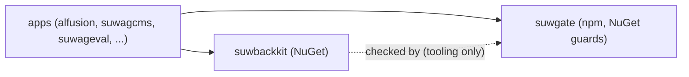

# Architecture

## What this repository is for

suwbackkit holds the .NET code that the backends of our apps share, published as NuGet packages, so an app takes a
version of it instead of a copy. A fix lands once and reaches every app with a version bump; a copy drifts.

- **Only code generalised from at least two apps comes here.** The second app that needs the same thing is what earns it a
  place; one app's need stays in that app, however general it looks. Before moving code here, compare the copies and keep
  only what they really share.
- No domain logic of any one app: what lives here is what any of our backends needs (server defaults, a CLI skeleton).
- One package per area, `Suwbackkit.<Area>`, so an app takes only what it uses. A new package arrives with its first code.

## Direction of dependencies

- Apps depend on suwbackkit; **suwbackkit never depends on an app**, never references one, and knows nothing of which apps use it.
- **suwgate does not depend on suwbackkit.** suwgate checks repositories, this one included; it ships no runtime code an app needs from here, and nothing here is a dependency of it.
- **suwbackkit uses suwgate only to be checked**: the CLI `@maniumek/suwgate` as the gate, `Suwgate.Architecture` (build defaults, with
  `PrivateAssets="all"`) and `Suwgate.Database` in the gate's test project. A shipped package never depends on suwgate; the gate's pack
  step fails when one does.
- Inside the repository: a package may use another package of the kit only when the second one exists for that reason; tests depend on what they test, never the other way.

## The map

- `Suwbackkit.slnx` — the .NET solution: the packages and their tests.
- `src/` — one folder per package; everything under it is packed (`src/Directory.Build.props` holds the package metadata). Each package has its own `README.md`, which nuget.org shows.
- `tests/` — one xUnit v3 test project per package (`<Package>.Tests`), plus `Suwbackkit.Gate`: the .NET guards of `Suwgate.Architecture` and `Suwgate.Database` run on the kit.
- `docs/` — this file and the specs: drafts in `draft/spec/`, built features in `visual/spec/`.
- `.github/workflows/ci.yml` — the gate and the consumer test (the template's gate on these packages), both suwgate's reusable workflow, on every push and pull request; on a version tag packing and publishing, which wait for both.
- `.claude/` — the committed Claude Code settings: `suwgate hook stop` runs the quick gate after a turn, `suwgate hook guard-edit` protects the gate and the generated files (`ALLOW_GATE_EDIT=1 claude` lifts the first).
- `.githooks/` — `pre-commit` runs `suwgate hook pre-commit` (gitleaks on what is staged, then the quick gate); `just sync` enables it.
- `.config/` — `dotnet-tools.json`: the pinned CSharpier.
- `.vscode/` — recommended extensions, formatter, file nesting and tasks that run the gate. No style rules: they live in `.editorconfig`, where CSharpier reads its width too.

Files at the root: `suwgate.yml` (the gate: profiles, the pack step, exceptions with their reasons), `layers.json` (which project may
reference which and see whose internals; each package is one flat namespace, its layers `["."]`, so a sub-namespace fails),
`package.json`, `pnpm-lock.yaml` and `pnpm-workspace.yaml` (the suwgate CLI, the only npm package), `Directory.Build.props` (the target
framework, warnings as errors, lock files, the `Suwgate.Architecture` build defaults, nothing packable by default), `Directory.Build.rsp`
(no idle MSBuild workers), `Directory.Packages.props` (every package version, once, with transitive pinning), `.editorconfig` (whitespace and CSharpier's width), `global.json`, `nuget.config`, `.gitattributes`, `.gitignore`.

## The packages

- The package `Suwbackkit.Server` follows .NET Aspire's ServiceDefaults: one `AddServerDefaults()` on the builder, one `MapServerDefaults()` on the app.
  Aspire ships it as a project inside each solution; here it is a NuGet package, so a fix reaches every app with a version bump.
  Unlike Aspire, `/health` and `/alive` are mapped in every environment, because the apps run them as container probes.
- PostgreSQL lives in a package of its own, `Suwbackkit.Postgres`, so an app without a database pulls in neither Npgsql nor grate; it does not depend on
  `Suwbackkit.Server`, it only adds a check to `AddHealthChecks()`, which both share through ASP.NET Core. Dapper stays the app's choice.
- The package `Suwbackkit.Testing` is for test projects only: the test-database helper and the log capture the apps copied. It knows no
  test framework, so an app's fixture keeps its own skipping and lifetime; it depends on Npgsql, not on `Suwbackkit.Postgres`. Its
  refusal of a database whose name lacks the word `test` is the rule every app's test database already followed (`<app>_test`, suwgate's
  `<app>_test_<checkout>`), turned into a guard, so a test run can never drop a development database.
- `Server`, `Postgres` and `Testing` reference the ASP.NET Core shared framework (`FrameworkReference Microsoft.AspNetCore.App`): every app using them is an ASP.NET Core app.
- The package `Suwbackkit.Cli` is the skeleton of an app's command line, taken from the twins in suwagcms and suwageval: the server
  address from named sources, the client side of the refusal format, `--open`, the command tree. It references System.CommandLine and
  not ASP.NET Core, because a CLI ships as a .NET tool without the web framework. What the two CLIs do differently (the root command,
  wrong use, help, exit codes, JSON output, configuration files, a typed or untyped client) stayed in the apps. The apps' SDKs share
  no code (an agent's endpoints, a bot's runtime), so there is no SDK package. The route table of "every route has a command" stays in
  each app's server tests too: the kit gives it `MappedRoutes` (`Testing`, which knows ASP.NET Core) and `CommandTree` (`Cli`).
- The public API is only what an app calls; the rest is internal and tested through `InternalsVisibleTo`.
- The tests that need PostgreSQL start it with Testcontainers (`postgres:17.11`, the image the apps' compose files pin). Without Docker
  they are skipped with a message that says how to run them; with `CI` set the missing Docker fails the run instead, so CI never passes
  without them.

## Packaging

Following the .NET library guidance and the NuGet docs:

- Every project under `src/` is packable and carries `PackageId`, `Description`, `Authors`, `PackageLicenseExpression` MIT,
  `RepositoryUrl`, `PackageReadmeFile`; everything else is `IsPackable=false` by default.
- Source Link is part of the .NET SDK since .NET 8 and on by default for GitHub, and so is embedding untracked sources;
  `PublishRepositoryUrl` writes the repository and the commit into the package.
- Symbols ship as a separate `.snupkg` (`IncludeSymbols`, `SymbolPackageFormat=snupkg`); `dotnet nuget push` of the `.nupkg` pushes the `.snupkg` beside it.
- Builds are deterministic (the SDK default); on GitHub Actions `ContinuousIntegrationBuild` also normalises the paths baked into the binaries.
- Packing writes to `artifacts/packages` (gitignored); the gate checks that each package gives both files and depends on no suwgate package.

## Versioning

**MinVer: the version comes from the git tag.** Tag `v0.1.0` builds `0.1.0`; a commit after it builds `0.1.1-alpha.0.<height>`;
before the first tag, `0.1.0-alpha.0.<height>` (`MinVerMinimumMajorMinor` 0.1).

- Why a tag and not a version in `Directory.Build.props`: the tag is the one place the version lives, so the published version cannot
  disagree with the release; there is no bump commit to forget, and a pre-release between tags can never be mistaken for a release.
- All packages share one version and one tag (`v*`), released together: the simplest scheme while the kit is small and its packages move together.
  When one package needs its own cadence, MinVer's documented monorepo setup applies: a `MinVerTagPrefix` per project (`server-v`, `cli-v`)
  with `MinVerIgnoreHeight`.
- MinVer needs the full history: suwgate's reusable NuGet release workflow, which the pack job calls, checks out with `fetch-depth: 0` and the tags (its gate workflow does too).

## Publishing

On a pushed tag `v*`, after the gate and the consumer test pass, the `pack` job of `ci.yml` calls suwgate's reusable NuGet release workflow, which packs every
package with the full history and keeps them as the artifact `nupkg`, and the `publish` job
pushes them to nuget.org with **NuGet trusted publishing**: GitHub issues the job an OIDC token, NuGet's login action exchanges it for an
API key valid one hour, and no long-lived key is stored anywhere. Before pushing, it checks that every package carries exactly the tag's
version. The publish job stays in `ci.yml`, not in a reusable workflow of suwgate: the nuget.org policy names this workflow file, and only
the publish job holds `id-token: write`; packing needs no token, so it is suwgate's.

The job does not run until the owner sets it up, so a tag without this setup publishes nothing:

1. On nuget.org, signed in as the account (or organisation) that will own the packages: user menu → Trusted Publishing → add a policy:
   repository owner `Manomenu`, repository `suwbackkit`, workflow file `ci.yml`, environment `nuget-org`.
2. On GitHub, in the repository's Settings → Secrets and variables → Actions → Variables: a repository variable `NUGET_USER` with the
   nuget.org profile name (not the e-mail). The job runs only when this variable is set.
3. Optionally, in Settings → Environments → `nuget-org`: required reviewers or a tag rule, so a publish waits for the owner's approval.

## The gate

suwgate (`suwgate check`, `just check`, the same in CI) with the profiles `dotnet` and `database` of `suwgate.yml`: the repository guards
(comments, escape hatches, docs paths, the map, hooks, banned and unused NuGet packages, connection strings, migrations), build with
warnings as errors, CSharpier, every test, the acceptance criteria, shellcheck and gitleaks, plus the kit's own step: pack every package
and check it gives a `.nupkg` and a `.snupkg` and depends on no suwgate package.

- The profile `database` applies because `Suwbackkit.Postgres` runs migrations: its guards keep the test migrations named and unchanged and the
  connection strings on `127.0.0.1`. Its `database-up` step has nothing to start: the tests start PostgreSQL with Testcontainers, so
  the compose file the profile asks for is an exception in `suwgate.yml`.
- The build rules, the banned APIs and the analyzer settings come from `Suwgate.Architecture`; the kit adds none of its own.
- The test project `Suwbackkit.Gate` runs every .NET guard of the two profiles in one test (`SuwgateGuards.VerifyAll`, given the two
  packages' assemblies and its own), and the `dotnet-test` step fails when one did not run. `guards.skip` in `suwgate.yml` leaves out,
  with its reason, the one that is for a server, which the kit is not: endpoints.

## Why some settings are as they are

- NuGet: `nuget.config` clears every source but nuget.org: with a second source central package management raises NU1507, and
  warnings as errors turn it into a failed build.
- Build workers: `Directory.Build.rsp` (`-nodeReuse:false`) leaves no MSBuild workers running after a build.
- Line endings: `.gitattributes` keeps LF everywhere, never normalises binaries, and marks the lockfiles as generated.
- CI pins every action, and suwgate's reusable workflow, by its commit; the step's name carries the version the commit is.
- An app logs which kit version it runs with `ServerKit.Version`.
- The package `Suwbackkit.Postgres` drops the `SELECT 1` the apps ran on every connection they opened: Npgsql advises against checking a connection
  on every open (a round trip each time, and still a race with the server) and offers `Keepalive` instead, which pings idle connections
  and drops the dead ones ([Npgsql FAQ](https://www.npgsql.org/doc/faq.html#broken_connection_from_pool)). With nothing left to wrap,
  the apps' `Pool` gave way to the `NpgsqlDataSource` itself.
- OpenAPI 3.1 is pinned twice: in `OpenApiOptions` for the document served at run time, and through the package's
  `buildTransitive` targets for the document written at build time, because `GetDocument.Insider` ignores `OpenApiOptions` and follows only
  `--openapi-version`. The build-time document is the contract the apps commit, and .NET 11 would make it 3.2.
- The `traceId` in ProblemDetails is overwritten with `Activity.Current.TraceId` (32 hex characters): ASP.NET Core's default is the whole
  W3C id (`00-<trace>--<flags>`), while the logs' scope carries the trace id alone, and the two must match to find a response in the logs.
